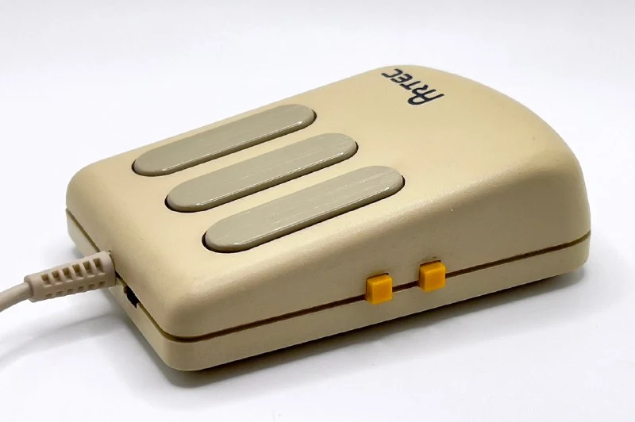
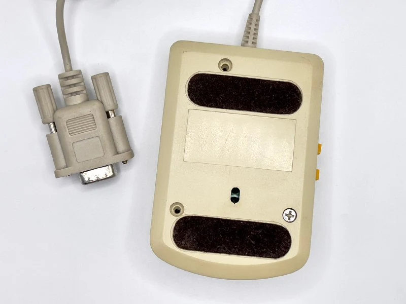
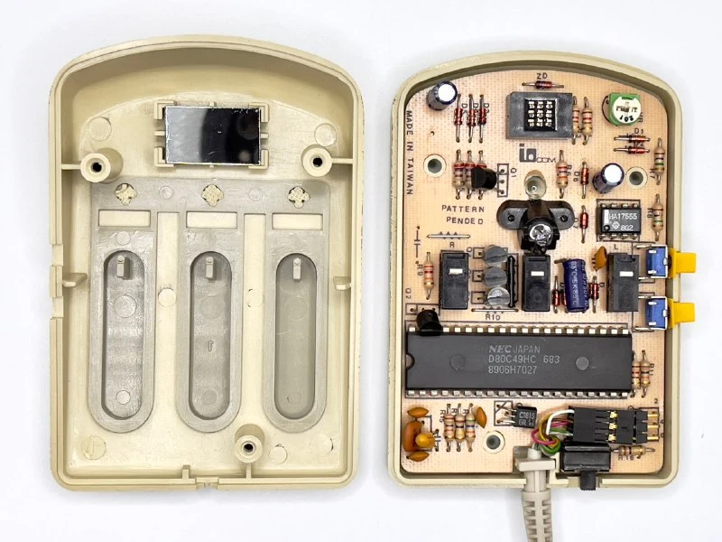
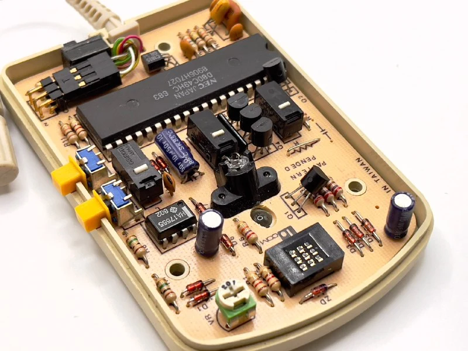
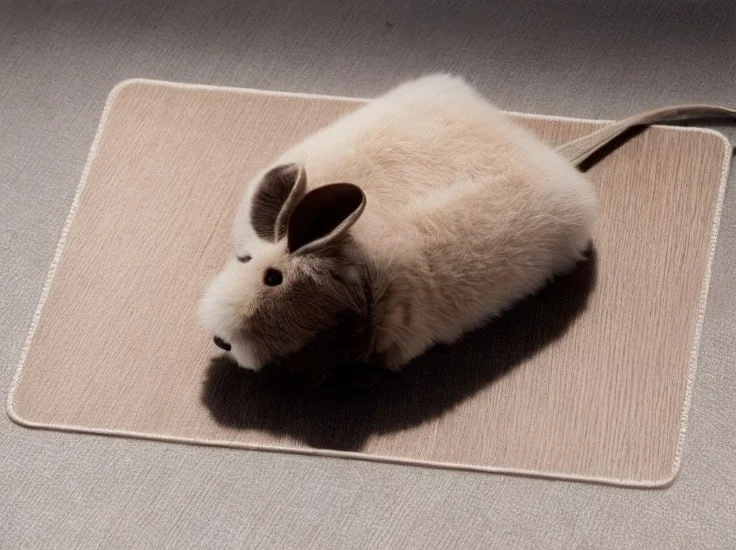

A pleasant mouse for small hands.

Inspired by the [MSC M2](https://collectionerus.ru/collections/old-mice/32/), the designers kept its buttons but shortened and rounded the case. With my fairly large hand, that leaves me able to press either the main buttons or the side ones.

The side buttons were evidently intended for frequent use alongside the main ones. Each locks one coordinate, letting you draw a strictly vertical or horizontal line, like holding Ctrl in a graphics application.

The mouse came with a five-year warranty and a guarantee of ten million clicks. It is optical, but uses an unusual nine-segment sensor I hadn't seen before. A special grid-patterned pad is required.

Another nice touch: it came with a little coat to protect it from dust when not in use.

